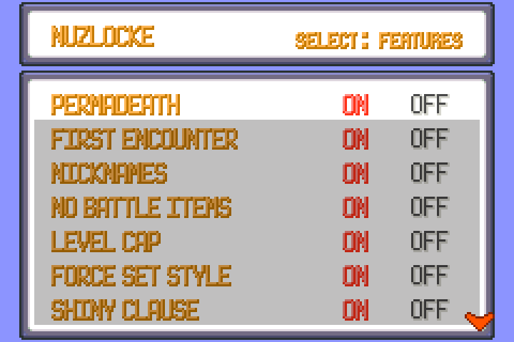
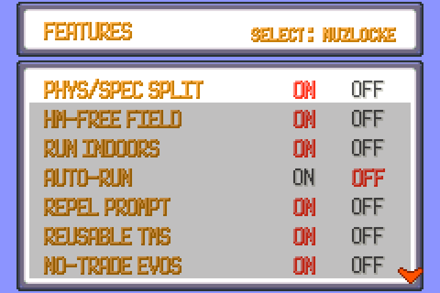
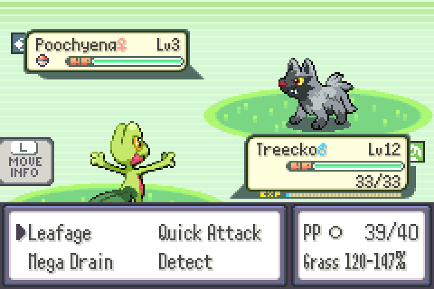
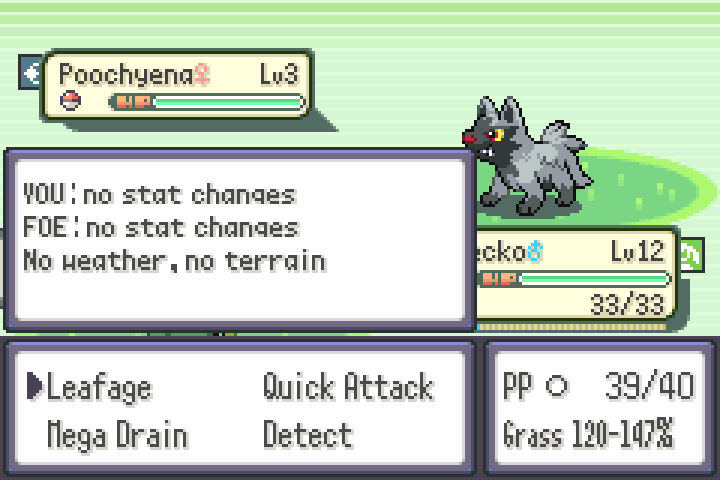
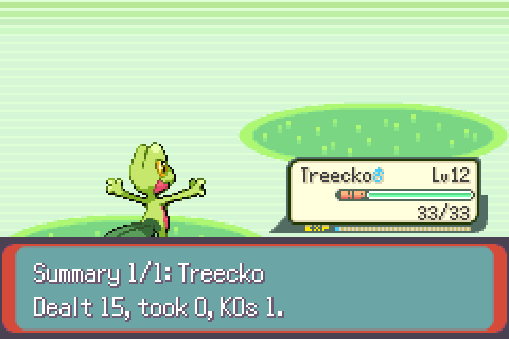
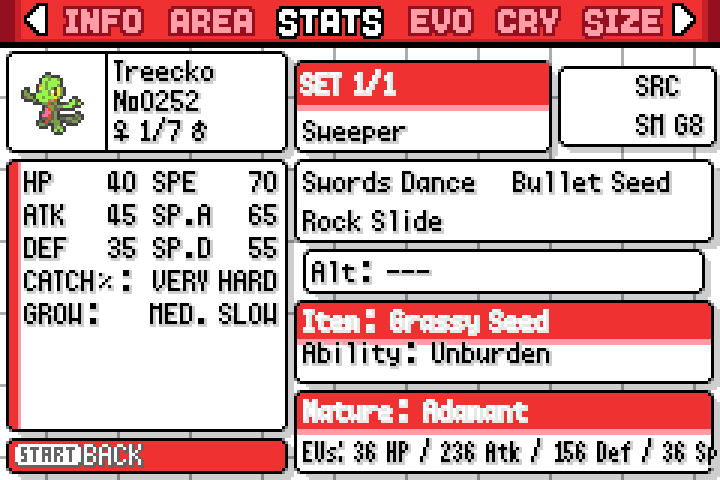
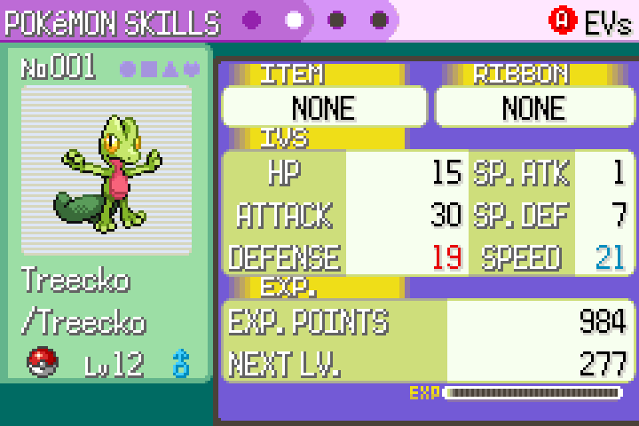
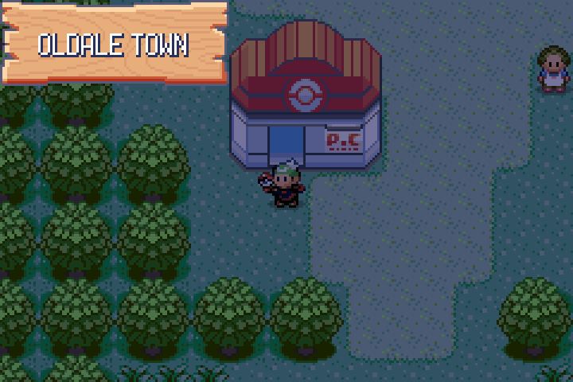
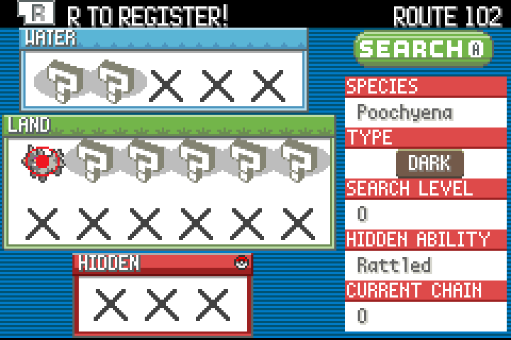
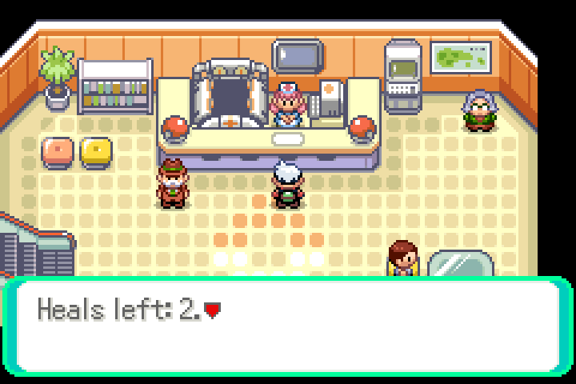

# Pokémon Emerald Nuzlocke Plus v1.0

**Emerald with the Nuzlocke rules built into the game.** Every rule and quality-of-life feature can be switched on or off from an in-game menu. The story, maps and trainers are vanilla Emerald. The engine is **pokeemerald-expansion 1.17.1**, so you get Gen 9 battle mechanics, the Fairy type, a physical/special split, and modern learnsets and abilities.

> **AI disclosure:** This hack was made almost entirely with an AI coding assistant: it wrote the code, the data tools and the docs. I came up with the features, directed the work and tested the game.

## Features

### Nuzlocke rules (NUZLOCKE page, shown when you start a new game, editable later from OPTION → SELECT)
The rules switch on once you receive the Pokédex.

- **Permadeath:** a fainted Pokémon is dead. Items, the Pokémon Center, Mom and the PC can't heal or revive it.
- **First encounter only:** one catch per route/area. Later encounters show "You can't catch this POKéMON." and you keep the ball.
- **Dupes clause:** a duplicate of an evolution line you already caught doesn't use up the area. Shiny clause takes priority.
- **Shiny clause:** shinies can always be caught.
- **Statics count:** optional, off by default.
- **Forced nicknames:** a nickname is required when you catch or receive a Pokémon.
- **No battle items:** you can't use bag items in battle (Poké Balls still work).
- **Forced SET battle style.**
- **Level cap:** set by the next Gym Leader's ace (15/19/24/29/31/33/42/46, then Elite Four 49/51/53/55 and Champion 58). Pokémon at the cap get 0 EXP and Rare Candies are blocked.
- **Pokémon Center heal limit:** unlimited, 2, 1 or 0 heals. Heals refill with each badge, or the number covers the whole game. The nurse shows "Heals left: N", and Mom and blackouts use the same counter.
- **Wiped party:** if your whole party is dead, there are no wild encounters or trainer battles until you take a living Pokémon out of the PC.

### Battle
- **Damage calculator:** shows the estimated damage as a % of the target's HP range in the move menu (e.g. "Normal 46–62%").
- **Battle info panel (R):** stat stages for both sides, weather/terrain with turns left, Trick Room, and type-effectiveness indicators.
- **Battle summary:** after each battle, damage dealt, damage taken and KOs for every Pokémon you used.
- **EXP multiplier:** x0.5 / x1 / x2 / x4. The level cap and permadeath still apply.
- **Physical/special split** (toggle), Gen 9 battle engine, Fairy type.

### Training
- **IV/EV viewer** in the summary screen (A cycles Stats → IVs → EVs).
- **Free move relearner** from the START menu, the summary screen, and an NPC in every Pokémon Center. It also offers egg, TM and tutor moves.
- **Pokémon Center helper:** shop with all 21 Mints, the EV-reducing berries and the Fresh-Start Mochi.
- **Party EXP Share** (toggle, off by default). Reusable TMs.
- **No-trade evolutions:** Kadabra, Machoke, Graveler and Haunter evolve at Lv 36. Item trade evolutions work by using the item from the bag.

### Exploration
- **HM-free field moves:** you need the HM in the bag, the badge, and a party Pokémon that can learn the move.
- **Fast travel:** FLY from the START menu or the Town Map, no Pokémon needed.
- **PC from the START menu.** Running indoors, optional auto-run, and a "use another Repel?" prompt.
- **DexNav:** see what lives on the current route and search for it.
- **Followers:** your first living Pokémon follows you.

### UI
- **HGSS-style Pokédex:** base stats, abilities, evolutions and learnsets, plus area. Seen-only species can open every page too.
- **Strategy Dex:** recommended competitive sets (moves, item, ability, nature, EVs) for 895 species, including 370 of #1–386. On a Pokédex entry press **START** to open them and **A** to see the next set.
- **Bigger bag** with sorting.
- **Everything configurable:** every feature can be toggled on the FEATURES page (OPTION → SELECT → SELECT).

## Download & patching
- **Download:** https://github.com/bk-sin/PokemonEmeraldNuzlockePlus/releases/latest (`Pokemon Emerald Nuzlocke Plus.bps`, ~16 MB)
- **Base ROM:** Pokémon Emerald (USA)
  - SHA1 `f3ae088181bf583e55daf962a92bb46f4f1d07b7`
  - CRC32 `1F1C08FB`
  - MD5 `605b89b67018abcea91e693a4dd25be3`
- **Patch tool:** apply the .bps with **Floating IPS (Flips)** or **[Rom Patcher JS](https://www.marcrobledo.com/RomPatcher.js/)**.
- **Patched ROM:** 32 MB, SHA1 `cced8cf8101bac7baf45d6f3047d91e7953a5100`, CRC32 `93AB9499`.
- **Saves:** Flash 128K. Tested on mGBA (recommended). Vanilla Emerald saves aren't compatible, so start a new game.

I can't share ROMs, so please don't ask.

## Known issues
- The battle summary, damage calc and other new screens are English only (the whole game text is English).
- Followers haven't been tested in every Emerald cutscene (truck, Team Aqua/Magma scenes, Sky Pillar…). If one looks odd, turn FOLLOWERS off.
- The Pokémon Center helper NPC is in every Hoenn Pokémon Center except **Lavaridge** and **Verdanturf** (different layout / tile already used). START → TOOLS → RELEARN works everywhere.
- The Emerald Elite Four don't level up on rematch, so the post-game level cap stays the same; after you become Champion there's no cap.
- In the Safari Zone, the Safari Ball just plays an error sound on an already-used area.
- Some later-generation evolution items (Protector, Electirizer…) aren't obtainable on the Hoenn map.
- The damage calc is an estimate: no crits, accuracy, Focus Sash/damage-reducing berries or Sturdy.
- Strategy Dex sets come from older metagames and were filtered to moves learnable in this game, so some sets are modified. Hidden Power is shown without its type. Some recommended items aren't obtainable, and 13 form-heavy species (Unown, Arceus, Vivillon…) show "No data".
- Level cap, permadeath, dupes clause and first encounter share their code with the FireRed version (tested there); in Emerald they were checked in code and in short tests, not in a full playthrough.
- The patch is large (~16 MB) because the ROM is 32 MB.

## Credits
- **pret** — pokeemerald decompilation
- **rh-hideout** — pokeemerald-expansion and all its contributors (see the expansion's CREDITS.md)
- **Pokéxperto** (pokexperto.net) — strategy set data, adapted from their Pokédex strategy pages. Licensed **CC BY-NC-SA 3.0**.
- **Smogon University** contributors — strategy sets, via data.pkmn.cc (pkmn project)
- **mGBA** — testing
- **Floating IPS / Rom Patcher JS** — patching
- **Pokémon** © Nintendo / Creatures / GAME FREAK. This is a free, non-commercial fan project.

**Hack by bk-sin — v1.0**

## Screenshots

